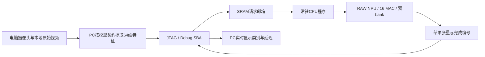

# 摄像头 → FPGA 多轮动作演示（RAW 备选版）

本演示按用户指定的备选基线 `0b5e34d29c3b0ac333461c0edba8197738906e1a` 开发。PC保存原始视频，并按模型契约提取64维特征；2026-11-21的个人现场校准版采用可见身体关节的静态姿势特征，旧画面运动特征仍按独立schema保留。FPGA上的真实CPU/NPU执行64→32→6 INT8分类器，PC读回结果并显示。视频分析在PC，动作分类在FPGA；完整图像不放进8KiB SRAM。



RAW完整SoC多轮仿真和真实FPGA数值回传均已通过：最终主机源码下100轮算术请求、12轮合成工程模型请求逐项匹配独立整数参考，换模型后重新装载8KiB镜像；另有同模型attach续跑验证。CPU JTAG在1MHz读到ID `0x00000001`、XLEN32。主机17项测试通过，实际读写使用物理地址SBA。最新证据见[真实板测记录](../../report/camera_board_20261120/README.md)，早期构建/RTL记录见[基线记录](../../report/camera_demo_raw0b_20261120/README.md)。真人动作数据与识别精度须单独采集验证；原UCI HAR传感器模型不能沿用到摄像头坐标。

2026-11-20已实际保存18段真人原始视频，共3714帧。原版本按整段动作标签计算的识别率为20.5%，见[原录像与真人模型板测结果](../../report/camera_video_20261120/summary.json)。改用运动特征、训练集归一化与增强后，同一批156个留出测试样本由32个识别正确增至63个，即40.4%；新一轮FPGA回放的六路整数分数仍全部匹配软件参考。调整记录见[运动特征与真实板测对比](../../report/camera_flow_20261120/summary.json)。左右臂仍较弱，尚不能作为可靠的六动作演示。原视频、图像、输入特征和真人模型权重只保留在本机。

同日又从[UTD-MHAD作者官网](https://personal.utdallas.edu/~kehtar/UTD-MHAD.html)取得8段右手挥动、下蹲RGB视频，核验后按本机视野裁切并统一左右方向，新增88个训练样本。相同52个验证样本正确数34→37，但原156个留出测试仍为63个正确（40.4%），且部分类别有退步，因此保留现有已板测模型。公开模板仅加入训练，不进入验证或测试；素材原文件不上传仓库。来源、哈希和对比见[公开动作模板实验](../../report/camera_public_templates_20261120/summary.json)。混合来源模型须明确记录`local-camera+public-templates`及公开素材出处，不能作为纯本地采集模型隐去来源。

## 软件与环境

静态个人校准版使用官方固定YOLO11n-pose资产，在PC提取COCO肩、肘、腕、髋、膝，头和脚不参与特征。髋中心/髋宽优先，图像边缘4%内不可靠关节置缺失mask；部分身体可推理，无人物时不提交请求。静态首帧即可生成特征，动作保持时不依赖画面继续运动。模型SHA与完整64维布局受[独立契约](static_features.py)校验，不能将旧HOF模型接到新前端。可选PC依赖列于[requirements-static-pose.txt](requirements-static-pose.txt)；资产来源为[官方YOLO11n-pose发布文件](https://github.com/ultralytics/assets/releases/download/v8.3.0/yolo11n-pose.pt)，须保存到`tools/local/camera_demo/yolo_pose_static_20261121/assets/yolo11n-pose.pt`或运行时用`--static-pose-model`指定位置，启动会核对SHA。

2026-11-21完成12段现场自动录制。按实际可见稳定姿势整理205帧，连同旧150帧训练；旧52帧仅作开发检查。个人校准拟合为200/205，旧开发集32/52，不是独立泛化测试，也不能与昨天156个测试样本的40.4%直接比较。407组校准/开发输入已在真实FPGA回放，六路INT8分数逐项一致。来源、聚合结果和限制见[现场校准与板测记录](../../report/camera_static_20261121/README.md)。个人视频、逐帧特征及训练权重均留在忽略目录。

实时主标题要求连续新FPGA结果、至少0.5秒跨度和整数分数差≥3才确认；不满足时显示识别中/不确定，无人物或结果过期时撤销确认。这是显示稳定策略，不计作准确率提升。原始类别、六路整数分数和序号仍完整记录；输入年龄包含PC姿态提取耗时。当前为个人校准实验版，真实新动作表现须现场确认。

静态姿势画面默认叠加绿色人体骨架：肩、肘、腕、髋、膝以绿点和绿线标出。骨架采用同一帧实际检测到且参与特征的有效点，低置信度、出画和缺失关节不补画；无人时清除。先从原始画面计算64维特征，再绘制骨架和镜像显示，因此显示不会进入模型输入，也不会改变模型权重或FPGA计算结果。绘制实现见[pose_overlay.py](pose_overlay.py)。

Windows PowerShell，在仓库根目录执行：

```powershell
powershell -NoProfile -ExecutionPolicy Bypass -File fpga/demo/setup.ps1
.\.venv-demo\Scripts\python.exe -m fpga.demo.doctor
```

依赖安装在 `.venv-demo`，姿态前端下载到忽略目录 `tools/local/camera_demo`。官方模型 URL 和 SHA 固定在 [assets.py](assets.py)，它只用于 PC 姿态检测；FPGA 动作模型由自己的摄像头样本训练。未下载视频和真人数据。

还需 Vivado（本机已找到 `D:/pkuwyh/Vivado/2019.1/bin/vivado.bat`）及 OpenOCD。本机 WSL Ubuntu 已安装 OpenOCD 0.12、usbutils，Windows 已安装 usbipd-win。安装依据：[微软 WSL USB 文档](https://learn.microsoft.com/en-us/windows/wsl/connect-usb)、[OpenOCD Tcl RPC](https://openocd.org/doc/html/Tcl-Scripting-API.html)。

## FPGA 配置与连接

目标器件为 `xc7a35tcsg324-1`，板载100MHz经Clock Wizard产生20MHz。[已板测RAW快照](../versions/20261120_rtl-0b5e34d_live-board-pass/README.md)复用先前通过布局布线的同一bitstream，SHA未变；没有因为主机兼容修复重新修改RTL或声明新的ASIC结果。以下命令供重新构建使用。

```powershell
& 'D:\pkuwyh\Vivado\2019.1\bin\vivado.bat' -mode batch -nojournal `
  -source fpga/demo/build_bitstream.tcl `
  -tclargs tools/local/camera_demo/bitstream_new
& 'D:\pkuwyh\Vivado\2019.1\bin\vivado.bat' -mode batch -nojournal `
  -source fpga/demo/program_bitstream.tcl `
  -tclargs tools/local/camera_demo/bitstream_new/fpga_top.bit
```

构建输出目录必须新建；只在资源、布线和时序通过后生成成功状态。空 SRAM bitstream 先配置 FPGA，模型与常驻程序再通过 JTAG 装载一次。运行不需要每轮重新烧录 FPGA，也不需要每轮重载权重。

板载配置链和 SoC 的 JTAG Debug 引脚是两条不同通路。现有顶层把 TCK/TMS/TDI/TDO 放在 E15/C15/E16/D15，沿用课程接线；下载链能看到 `xc7a35t`，不代表 OpenOCD 已能访问内部 CPU。独立 FT232H 适配器通常为 `0403:6014`，板载复合设备为 `0403:6010`。不应将后者的 FPGA 配置 TAP 当成 RISC-V DTM。以实际接线和 TAP 探测结果为准。

本机照片已确认板卡为EGo1，下载器外观与课程ALINX USB CABLE一致。按[课程Lab6第8.2节](https://full-stack-ai-chip.tianyuj.com/lab-6/#82-jtag)和[EGo1手册第14节](https://e-elements.readthedocs.io/zh/ego1_v2.2/EGo1.html)核对完整六线连接：

| 下载器信号 / FT232H | EGo1 J5针号 | FPGA封装引脚 / 方向 |
| --- | --- | --- |
| TCK / AD0 | 17 | E15，适配器输出 |
| TDI / AD1 | 18 | E16，适配器输出 |
| TDO / AD2 | 19 | D15，适配器输入 |
| TMS / AD3 | 20 | C15，适配器输出 |
| GND | 33或34 | 共地 |
| VREF | 35或36 | +3.3V，下载器参考电压输入 |

此前五线说明遗漏了该款下载器的VREF，已更正；不能只按裸FT232H的四根GPIO加GND描述外接成品下载器。VREF用于目标电平参考，不用于给开发板供电，也不能接5V。

课程图针对下载器端面2×5插口：标签面朝上、正对该插口看，上排从左到右为`TDI / 空 / TMS / TDO / TCK`，下排为`GND / 空 / 空 / VREF / GND`。这一顺序不适用于外壳顶部的长窗口插针。J5为2×18排针。本机EGo1已通过背面首针方形焊盘核实：正面朝向自己、VGA在上时，最上方左=1、右=2；左列奇数、右列偶数，向下递增。第9对17/18、第10对19/20；倒数第二对33/34为GND，最后一对35/36为3.3V。正反面左右相反；不同板卡应自行核实首针标记。

E15等是FPGA封装脚号，不是排针号。两根USB都需连接：板载USB负责供电/配置，外接适配器负责CPU调试。VREF不能替代开发板供电。若开发板断电，需先重新配置bitstream再装模型。早期全0/全1诊断保存在[照片与接线复核](../../report/jtag_photo_recheck_20261120/README.md)；接线调整并恢复板载USB后，10kHz、100kHz及1MHz均成功识别CPU，最终数值板测通过。TAP复位仍受外部复位和MMCM锁定控制。

启动已安装的WSL并附加外接适配器后，在仓库根目录启动OpenOCD：

```powershell
wsl -e openocd -f /mnt/c/Users/wyh/Desktop/chipcourse/chip_design_demo_raw0b/fpga/demo/openocd_ft232h.cfg
```

成功标志包括`tap/device found: 0x00000001`、`Examined RISC-V core`和`XLEN=32`；端口监听本身不代表连接成功。若仍含`all zeroes`、`all ones`、`IR capture error`或`dtmcontrol is 0`，应先恢复CPU调试链，再装固件。RTL默认ID的厂家字段为0，OpenOCD会显示厂家`<invalid>`；不能将它和扫描失败混淆。

WSL使用USB/IP时，先在Windows执行`usbipd list`核对适配器BUSID；管理员执行一次`usbipd bind --busid BUSID`，再`usbipd attach --wsl --busid BUSID`。只将外接FT232H附加WSL，板载下载口留给Vivado。Tcl RPC端口为6666。主机强制`sysbus`并给SRAM/MMIO读写显式加`phys`，避免运行中hart的虚实地址探测；每轮不halt CPU。OpenOCD0.12使用`tcl_notifications`/`tcl_trace`，新版命令不存在时才回退，实际错误继续报告。

## 采集与训练动作

默认六类是站立、左臂抬起、右臂抬起、双臂抬起、下蹲、侧倾；它们是演示标签，尚无已验证真人分类器。可以用 `--labels` 提供六个其他标签，但训练、采集、显示必须使用同一份标签顺序。

当前采集先保存原始视频，再离线分析。录像器完全不运行姿态检测，也不根据身体完整性、关键点数量或姿态识别结果拒绝保存。能拍到手、腿和膝盖即可，不要求头或脚入镜。

点击摄像头窗口，按SPACE开始当前动作，按ENTER保存并切换下一个动作。开始和结束使用不同按键，避免键盘连发把一次开始误判成结束。每段建议约10秒，分三轮、每轮六类；全程手动控制。Q或关闭窗口会保留已完成视频及正在录制的部分视频，部分段会标记，原文件不会因分析结果被删除。

录像使用原始1280×720整帧，提示栏只显示在预览中，保存的AVI不含文字、镜像或骨架。每帧另存真实采集时间，离线分析使用时间记录，而不是把视频容器的标称帧率当作真实采样时间。视频和特征默认保存在忽略目录`tools/local/camera_demo`，不上传GitHub；不录音。本机DirectShow支持1倍缩放；镜头不支持的软件“广角”不会改变真实视野。

```powershell
.\.venv-demo\Scripts\python.exe -m fpga.demo.record_video `
  --camera-backend dshow --width 1280 --height 720 --zoom 100 `
  --rounds 3 --output-dir tools/local/camera_demo/video_capture
.\.venv-demo\Scripts\python.exe -m fpga.demo.analyze_video `
  --manifest tools/local/camera_demo/video_capture/manifest.json `
  --output tools/local/camera_demo/actions.npz
.\.venv-demo\Scripts\python.exe -m fpga.demo.train_camera `
  --dataset tools/local/camera_demo/actions.npz `
  --out tools/local/camera_demo/my_action_model
```

`run_demo.ps1 -Action collect -VideoDir NEW_DIRECTORY`启动该录像流程，`-Action analyze-video`提取特征。中文界面使用本机微软雅黑/Pillow，无中文字体时显示英文，不下载字体。

当前`flow`特征为64维：将整幅画面分成4×4格，每格统计向左、右、上、下的运动量。使用实际时间间隔约0.25秒的光流，减去整幅画面的中位移动量以缓解相机抖动，再按训练集统计的尺度归一化。[flow_features.py](flow_features.py)由离线导出和实时推理共用，无需MediaPipe或头、脚、完整身体；初始化零运动是实际时间窗的状态，不代表伪造的“完整姿态”。

[flow_training.py](flow_training.py)提供`train_feature_scale`、`augment_flow`和`fit_flow_head`。只用训练集拟合尺度和生成增强；镜像时同时交换左右运动方向与左右臂标签，时间反转保持动作类别。增强样本不计为新的独立录制。选定权重在最终测试前冻结，量化校准也只用训练集；当前网络仍为64→32→6，RTL和bitstream均未修改。

上面的`analyze_video`通用命令保留兼容的`video`版本：10个上肢、髋、膝关键点的位置、显式缺失掩码、位移以及真实图像统计。它不拒绝缺失姿态的帧，但在这批数据上识别较差，因此未用于最新已装载的模型。

每个动作片段作为独立session，训练/验证/测试按完整session划分，避免相邻重叠帧随机切分造成精度虚高。训练需要六类各至少三个完整片段及足够样本；不同人的泛化需另采独立测试数据。识别精度由实际测试结果决定。

旧`full`和`knees`特征版本仍保留，入口为`camera collect`或`run_demo.ps1 -Action collect-features`，供兼容已有数据；新旧版本不能追加到同一数据集或混用模型。当前用户采集使用原视频流程，不再使用关键点完整性门控。

实验性`image_grid64_v4`直接使用8×8图像灰度空间特征，实时推理无需MediaPipe。该方案在本次独立片段验证中仍不稳定，尚未替换为已验证动作模型。训练清理过的片段时，可用`train_camera --session-split MAP.json`固定原始片段分组；不得把同一片段拆成新的“独立”训练和测试session。缺失的验证类别会记录为空，不计为识别成功。

训练工具生成浮点权重、定点校准、`compiled/` 原始任务包以及 `resident/` 常驻程序包。第一层完整 32×64 块使用 RAW NPU，重标定及第二层 32→6 边缘计算由 FPGA 内的 CPU 完成；逐层后端与 RAW 工作量写入 metadata。至少必须有真实 RAW NPU 工作，否则拒绝作为此演示模型。测试集精度和浮点/量化分类一致性会单独记录。合成样本仅可用于流程测试，不能代替真人精度。

## 连续推理

配置 FPGA、启动 OpenOCD，随后执行：

```powershell
.\.venv-demo\Scripts\python.exe -m fpga.demo.camera run `
  --package tools/local/camera_demo/my_action_model/resident
```

本机已保存最新模型指针`tools/local/camera_demo/ACTIVE_CAMERA_MODEL.json`，`run_demo.ps1 -Action run`在未指定`-Model`时读取它，并复用本次上电已装载的常驻程序。指定模型时可显式加`-Attach`复用同一模型；标签、特征契约及程序tag均会核对。启动前仍需让OpenOCD调试服务可用。

启动时装载 8192 字节镜像、逐字回读、提交 boot key，CPU 开始等待请求。已装载相同模型且处于空闲状态时可加 `--attach`。更换模型需要复位并重新装载；模型标签和 FPGA 程序 tag 必须匹配。界面只把 FPGA 返回的结果显示为 FPGA 结果，连接错误、超时、过期结果会明确显示。单个后台推理线程最多保留一份最新待处理特征，避免 USB 较慢时无限排队。

不用摄像头也可先检验多轮数值回传：

```powershell
.\.venv-demo\Scripts\python.exe -m fpga.demo.host PATH_TO_RESIDENT `
  --inputs inputs.json --int8 --expected expected.json `
  --output tools/local/camera_demo/board_results.jsonl
```

`inputs.json` 是二维列表，每行一组新输入；`--int8` 表示有符号 INT8，省略则按模型 input_scale 量化浮点特征。`expected.json` 是独立整数参考输出，只供 PC 核对，不会作为 FPGA 输出写入芯片。

## 请求/结果协议

邮箱占 SRAM 顶端 64 B，基址 `0x80001fc0`，实际输入输出地址由 `manifest.json/live_demo` 给出。只有一个未完成请求：host 先写输入和命令，最后写非零 `request_seq`；CPU 先写完整结果、状态、错误和计时，最后写 `response_seq`。host 只接受编号匹配且状态 DONE 的结果，重复编号不重跑；超时保留该 slot，可等待原请求恢复，不能覆盖仍在计算的输入。

| 偏移 | 字段 | 写入方 |
| --- | --- | --- |
| 0 / 4 | LIVE magic / ABI version | 固件 |
| 8 / 12 | request_seq / response_seq | PC / CPU |
| 16 / 20 | command / input_bytes | PC |
| 24 / 28 | status / error | CPU |
| 32 / 36 / 40 | cycles / executions / argmax | CPU |
| 44 / 48 / 52 | output_bytes / input_address / output_address | 固件 |
| 56 / 60 | model/program tag 低字 / 高字 | 固件 |

常驻 CPU 程序每轮装入新输入，调度 RAW NPU 和 CPU 内核重新计算激活并写回输出。权重与量化参数固定在模型包，输入和中间激活不再固定为启动镜像的测试值。完整 ABI 在 [protocol.py](protocol.py)，生成入口在 [firmware.py](firmware.py)。输出为编译器的 INT8 分数，不是概率。

`cycles` 记录 CPU 接受请求至结果公布，不包含摄像头、特征时间窗、USB/JTAG 搬运和主机显示。界面另显示电脑端往返延迟，不能把功能仿真时钟或周期数当成实际摄像头 FPS。

常驻程序持续等待下一轮，不写旧自检的 PASS 标记；心跳灯继续闪烁属于正常现象。是否成功以请求编号、返回状态和结果比对为准。

## 开发验证

```powershell
.\.venv-demo\Scripts\python.exe -m unittest discover -s test/int8 -p 'test_camera*.py' -v
.\.venv-demo\Scripts\python.exe -m unittest discover -s test/int8 -p 'test_*video*.py' -v
.\.venv-demo\Scripts\python.exe -m unittest discover -s test/int8 -p 'test_flow_training.py' -v
.\.venv-demo\Scripts\python.exe -m unittest discover -s test/unit -p 'test_live_host.py' -v
python tools/project.py check
```

完整 SoC 多轮测试入口是 [run_live_demo.py](../../test/int8/run_live_demo.py)，需要 Xcelium。该 bench 经 Debug SBA/AXI 边界在 CPU 运行时送数据，覆盖多轮、重复请求、错误参数和恢复；它没有模拟 USB 物理设备或完整串行 JTAG 电气链。主机 fake transport 测试也不作为板测证据。

本机 RAW 工作目录通过 `.venv-demo` junction 复用同工作区的已安装环境；新电脑运行 setup 会创建独立环境。本版本保持原始 RAW RTL 及其默认四样本能力，没有使用任务引擎分支的单样本 RTL 改动。

真人 camera run 默认拒绝 synthetic/未知来源模型。`--allow-synthetic-engineering-test` 仅供明确的工程检查，并在界面持续显示工程测试标记，不能据此宣称识别准确率。
