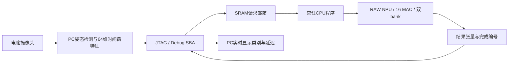

# 摄像头 → FPGA 多轮动作演示（RAW 备选版）

本演示按用户指定的备选基线 `0b5e34d29c3b0ac333461c0edba8197738906e1a` 开发。PC 用摄像头和 MediaPipe 提取姿态，FPGA 上的真实 CPU/NPU 执行 64→32→6 INT8 分类器，PC 读回结果并显示。姿态提取在 PC，动作分类在 FPGA；不是将整张图像或 MediaPipe 网络放进 8 KiB SRAM。



软件入口与 RAW 完整 SoC 多轮功能仿真已通过。实时板测、真人采样后的分类精度、USB 实际吞吐仍须实测。每一项验证状态见 [本轮记录](../../report/camera_demo_raw0b_20261120/README.md)。原 UCI HAR 模型输入是惯性传感器特征，不能给它塞入摄像头坐标后沿用原准确率。

## 软件与环境

Windows PowerShell，在仓库根目录执行：

```powershell
powershell -NoProfile -ExecutionPolicy Bypass -File fpga/demo/setup.ps1
.\.venv-demo\Scripts\python.exe -m fpga.demo.doctor
```

依赖安装在 `.venv-demo`，姿态前端下载到忽略目录 `tools/local/camera_demo`。官方模型 URL 和 SHA 固定在 [assets.py](assets.py)，它只用于 PC 姿态检测；FPGA 动作模型由自己的摄像头样本训练。未下载视频和真人数据。

还需 Vivado（本机已找到 `D:/pkuwyh/Vivado/2019.1/bin/vivado.bat`）及 OpenOCD。本机 WSL Ubuntu 已安装 OpenOCD 0.12、usbutils，Windows 已安装 usbipd-win。安装依据：[微软 WSL USB 文档](https://learn.microsoft.com/en-us/windows/wsl/connect-usb)、[OpenOCD Tcl RPC](https://openocd.org/doc/html/Tcl-Scripting-API.html)。

## FPGA 配置与连接

目标器件为 `xc7a35tcsg324-1`，板载 100 MHz 经 Clock Wizard 产生 20 MHz。该 RAW 硬件需要重新构建，不能拿 11 月 4 日的历史 bitstream 宣称运行该 RAW 硬件。

```powershell
& 'D:\pkuwyh\Vivado\2019.1\bin\vivado.bat' -mode batch -nojournal `
  -source fpga/demo/build_bitstream.tcl `
  -tclargs tools/local/camera_demo/bitstream_new
& 'D:\pkuwyh\Vivado\2019.1\bin\vivado.bat' -mode batch -nojournal `
  -source fpga/demo/program_bitstream.tcl `
  -tclargs tools/local/camera_demo/bitstream_new/fpga_top.bit
```

构建输出目录必须新建；只在资源、布线和时序通过后生成成功状态。空 SRAM bitstream 先配置 FPGA，模型与常驻程序再通过 JTAG 装载一次。运行不需要每轮重新烧录 FPGA，也不需要每轮重载权重。

板载配置链和 SoC 的 JTAG Debug 引脚是两条不同通路。现有顶层把 TCK/TMS/TDI/TDO 放在 E15/C15/E16/D15，沿用课程接线；下载链能看到 `xc7a35t`，不代表 OpenOCD 已能访问内部 CPU。独立 FT232H 适配器通常为 `0403:6014`，板载复合设备为 `0403:6010`。不应将后者的 FPGA 配置 TAP 当成 RISC-V DTM。以实际接线和 TAP 探测结果为准。

WSL 使用 USB/IP 时，先在 Windows 执行 `usbipd list`，核对适配器 BUSID；管理员终端执行 `usbipd bind --busid BUSID`，再 `usbipd attach --wsl --busid BUSID`。不要把摄像头或仍由 Vivado 使用的下载接口误传进 WSL。进入 WSL 启动适配器对应的 OpenOCD 配置，Tcl RPC 端口为 6666。主机程序强制使用 `sysbus`，运行中读写 SRAM，不以每轮 halt CPU 的方式代替常驻服务。不同版本的内存访问命令已兼容处理。

## 采集与训练动作

默认六类是站立、左臂抬起、右臂抬起、双臂抬起、下蹲、侧倾；它们是演示标签，尚无已验证真人分类器。可以用 `--labels` 提供六个其他标签，但训练、采集、显示必须使用同一份标签顺序。

```powershell
.\.venv-demo\Scripts\python.exe -m fpga.demo.camera collect `
  --output tools/local/camera_demo/actions.npz
.\.venv-demo\Scripts\python.exe -m fpga.demo.train_camera `
  --dataset tools/local/camera_demo/actions.npz `
  --out tools/local/camera_demo/my_action_model
```

引导采集分三轮、每轮六类。按 SPACE 确认当前动作，再倒计时后采集；Q 退出。保存的是 64 维特征、标签、独立 session 标识，不保存原视频。每类至少三次独立 session，训练/验证/测试按 session 切分，避免相邻重叠帧随机切分造成精度虚高。若要检验对不同人的泛化，应额外采集不同人的独立测试 session。

特征契约为 16 个身体关键点的归一化二维位置 32 维，加约 1 秒窗口的位移 32 维。坐标以髋中心平移、躯干尺度归一化；具体关键点、缺失检测和窗口规则见 [features.py](features.py)。采集与推理共用同一实现和特征版本。丢失姿态时不发送伪造的零输入。

训练工具生成浮点权重、定点校准、`compiled/` 原始任务包以及 `resident/` 常驻程序包。第一层完整 32×64 块使用 RAW NPU，重标定及第二层 32→6 边缘计算由 FPGA 内的 CPU 完成；逐层后端与 RAW 工作量写入 metadata。至少必须有真实 RAW NPU 工作，否则拒绝作为此演示模型。测试集精度和浮点/量化分类一致性会单独记录。合成样本仅可用于流程测试，不能代替真人精度。

## 连续推理

配置 FPGA、启动 OpenOCD，随后执行：

```powershell
.\.venv-demo\Scripts\python.exe -m fpga.demo.camera run `
  --package tools/local/camera_demo/my_action_model/resident
```

启动时装载 8192 字节镜像、逐字回读、提交 boot key，CPU 开始等待请求。已装载相同模型且处于空闲状态时可加 `--attach`。更换模型需要复位并重新装载；模型标签和 FPGA 程序 tag 必须匹配。界面只把 FPGA 返回的结果显示为 FPGA 结果，连接错误、超时、过期结果会明确显示。单个后台推理线程最多保留一份最新待处理特征，避免 USB 较慢时无限排队。

不用摄像头也可先检验多轮数值回传：

```powershell
.\.venv-demo\Scripts\python.exe -m fpga.demo.host PATH_TO_RESIDENT `
  --inputs inputs.json --int8 --expected expected.json `
  --output tools/local/camera_demo/board_results.jsonl
```

`inputs.json` 是二维列表，每行一组新输入；`--int8` 表示有符号 INT8，省略则按模型 input_scale 量化浮点特征。`expected.json` 是独立整数参考输出，只供 PC 核对，不会作为 FPGA 输出写入芯片。

## 请求/结果协议

邮箱占 SRAM 顶端 64 B，基址 `0x80001fc0`，实际输入输出地址由 `manifest.json/live_demo` 给出。只有一个未完成请求：host 先写输入和命令，最后写非零 `request_seq`；CPU 先写完整结果、状态、错误和计时，最后写 `response_seq`。host 只接受编号匹配且状态 DONE 的结果，重复编号不重跑；超时保留该 slot，可等待原请求恢复，不能覆盖仍在计算的输入。

| 偏移 | 字段 | 写入方 |
| --- | --- | --- |
| 0 / 4 | LIVE magic / ABI version | 固件 |
| 8 / 12 | request_seq / response_seq | PC / CPU |
| 16 / 20 | command / input_bytes | PC |
| 24 / 28 | status / error | CPU |
| 32 / 36 / 40 | cycles / executions / argmax | CPU |
| 44 / 48 / 52 | output_bytes / input_address / output_address | 固件 |
| 56 / 60 | model/program tag 低字 / 高字 | 固件 |

常驻 CPU 程序每轮装入新输入，调度 RAW NPU 和 CPU 内核重新计算激活并写回输出。权重与量化参数固定在模型包，输入和中间激活不再固定为启动镜像的测试值。完整 ABI 在 [protocol.py](protocol.py)，生成入口在 [firmware.py](firmware.py)。输出为编译器的 INT8 分数，不是概率。

`cycles` 记录 CPU 接受请求至结果公布，不包含摄像头、特征时间窗、USB/JTAG 搬运和主机显示。界面另显示电脑端往返延迟，不能把功能仿真时钟或周期数当成实际摄像头 FPS。

## 开发验证

```powershell
.\.venv-demo\Scripts\python.exe -m unittest discover -s test/int8 -p 'test_camera_demo.py' -v
.\.venv-demo\Scripts\python.exe -m unittest discover -s test/unit -p 'test_live_host.py' -v
python tools/project.py check
```

完整 SoC 多轮测试入口是 [run_live_demo.py](../../test/int8/run_live_demo.py)，需要 Xcelium。该 bench 经 Debug SBA/AXI 边界在 CPU 运行时送数据，覆盖多轮、重复请求、错误参数和恢复；它没有模拟 USB 物理设备或完整串行 JTAG 电气链。主机 fake transport 测试也不作为板测证据。

本机 RAW 工作目录通过 `.venv-demo` junction 复用同工作区的已安装环境；新电脑运行 setup 会创建独立环境。本版本保持原始 RAW RTL 及其默认四样本能力，没有使用任务引擎分支的单样本 RTL 改动。

真人 camera run 默认拒绝 synthetic/未知来源模型。`--allow-synthetic-engineering-test` 仅供明确的工程检查，并在界面持续显示工程测试标记，不能据此宣称识别准确率。
