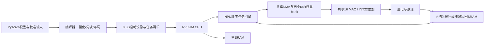

# 当前架构与数据流

my_soc_top保留clk_i、rst_ni、tck_i、tms_i、td_i、td_o六个信号端口。CPU指令、CPU数据、Debug SBA、DMA是四个AXI发起端；Boot、主SRAM、Debug映射、NPU是四个目标端。

编译器将支持的连续FC和激活合成执行段。CPU提交任务表地址和数量，NPU自行完成描述符、输入、bias、权重搬运及结果提交；遇到Add/Sub/Mul/Softmax等CPU内核时在SRAM交接。形状/整数语义/布局全部符合且成本合适时，编译器可选择原始双层专用模式。

共享阵列为16个INT8 MAC。一次FC块K≤64、N≤32、batch≤4，沿K保留INT22部分和，最后K块才量化；沿N更换输出块。任务内64B权重循环由硬件完成，不为每64B生成描述符。

内部h为4×32字节，与原专用隐藏激活共用。编译器只在单消费者、形状允许且旧输入不再使用时内部转发；多N块、分支或CPU消费者通过SRAM。当前不复用不同物化张量的SRAM地址区间。

CPU指令缓存为4条×32B。SRAM实际字节写入按物理地址撤销匹配缓存行，包含地址别名；已发填充继续排空。主SRAM总8KiB，容纳机器码、权重、bias、LUT、张量和邮箱，超容量在编译时拒绝。

复位、启动及事务边界见[SRAM协议](sram.md)，整数和完成规则见[任务ABI](../compiler/TASK_ABI.md)，当前测量见[结果](results/README.md)。
