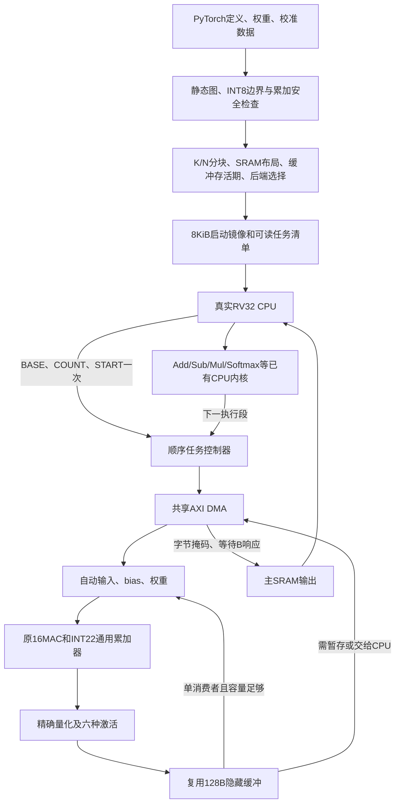

# 模型、任务表与SoC执行

这轮真正新增了硬件任务控制和通用后处理。PyTorch不在芯片上运行；CPU也没有增加新指令。编译器把支持的静态整数算子编成NPU任务表，把已有CPU内核编成RV32IM程序，二者共同装入现有8KiB SRAM。

## 谁决定分块

流片后的硬件只需知道每条任务的K、N、batch和地址。编译器在编译模型时决定沿K按64、沿N按32分块，生成初始化、续算、最后K块、量化和激活参数。任务控制器读取并顺序执行，不需要用户手算块数。

例如65→41→9的FC链，首层沿K分成64+1，沿N分成32+9，共4条FC描述符；次层41→9用1条，共5条。两层和可融合激活放在同一个执行段，CPU只启动一次。每条描述符内部仍循环预取权重：此例共87次权重DMA，而不是87条任务；64B是bank容量，输出尾块的权重tile可更短。

首层输出41个元素超过内部每样本32个元素的容量，必须写回SRAM；次层自动读入，不由CPU逐元素搬。多消费者、多个N块、CPU交接也采用保守写回。48→24→8等满足单消费者和覆盖条件时，中间结果通过h→x交接，省去层间SRAM搬运。编译器仍保留中间张量的保守地址分配，当前没有声称做到最优SRAM容量复用。

## 共享哪些硬件

- 全部通用FC使用原a1[4][32] INT22累加器和16个INT8 MAC；原a2[4][6]保持专用结构。
- NONE/ReLU/ReLU6/LeakyReLU共用一个精确缩放器；INT22×INT32分四次字节乘加，宽乘积/舍入保留54位。Sigmoid/Tanh共用查表路径和一字缓存。
- 打包输出和内部交接复用原h[4][32]字节缓冲，统一字节写端口及32位读选择。没有为通用FC2再建一套32输出累加器。
- 原MODE0的高速正数重定标保留，以维持原专用程序周期；通用整数缩放和原专用量化是两个受不同模式控制的算术通路。
- CPU、Debug、主SRAM、128B取指缓冲、AXI结构和复位契约沿用已接受基线。DMA扩展为受控输入/偏置/描述符/LUT装载及结果写回。

## 整数边界与失败

FC最后K块完成后先量化到INT8，再执行激活。融合只省调度/存储，保留这次舍入及饱和；不能直接把两个缩放系数相乘。普通FC的全输入域累加超出INT22时用已有CPU INT32实现；CPU整数运算也需要通过范围证明。

结果写回逐行打包，尾字使用字节掩码，最后一个AXI B响应成功后才提交。复位/DMA失败撤销当前输出、部分和和内部缓冲有效标记；已写入的SRAM字节不会回滚。忙时配置/启动被拒绝，不取消已接受执行段或在途AXI事务。

## 特化选择

64→32→6只是必要条件之一。还要满足无分支FC→ReLU→FC、所有INT22安全证明、ReLU在全部256个INT8输入上为精确恒等重标定、首层系数能精确约简到原UINT16乘法器、权重布局匹配。编译器将第二层权重明确重排成旧MODE0的四个48B包。

单样本匹配用例测得通用任务更快，成本策略保留通用路径；多样本匹配样例可选原专用通路。每次选择和理由写入manifest及task_plan。原四样本2700拍固件独立保留，不能把一个新生成程序的周期冒充该基准。

## 当前范围

支持静态二维、batch1..4的PyTorch FX图及已注册算子。CPU回退目前包括Linear、六种激活、Add/Sub/Mul、Identity及Softmax等内核。未注册的Conv/Pooling/Attention等算子明确拒绝编译；这不是在无FPU的CPU上运行任意PyTorch。代码、权重、任务、LUT、全部数据总量必须放进8KiB。

真实SoC功能、面积、TT SDF和Lab5状态分别见 [总状态](README.md)，不要把功能通过等同于物理通过。
