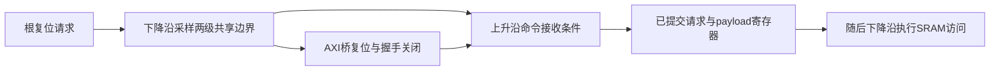

# SRAM请求寄存器复位边界修复

本轮修复针对0d48a66完整物理实现后的TT后仿最终复位事件。该物理版同源34步和三个阶段均退出0，含PAD整颗3.7956390976mm²，四角最终时序/电气/物理检查通过；TT负IOPATH截零已为0，SS125 Setup从基线+0.001ns增至+0.290ns。但TT的17个功能场景中仍有1条最终复位Hold事件，因此整体SDF验收没有通过，也没有启动它的快/慢角后仿。旧物理版不能证明本页新RTL已通过。

## 先确认D跳变来源

对原失败固件10001及1650ps复位偏移重编译，只加入只读波形探针，保留原网表、SDF、原生模型、输入固件、时钟、复位激励和所有notifier/时序检查。原始输入SHA在运行前后完全一致；同一违规及时间原样复现。[诊断记录](../eda/results/port_request_reset_20261029/diagnosis.json)记录身份与测量。

| 事件 | 时间/ns | 含义 |
| --- | --- | --- |
| 外部复位下降 | 238881.650 | 测试台原始复位相位 |
| 全局ndmreset_n下降 | 238887.505 | 经过原根复位网络 |
| 主存局部rst_ni下降 | 238890.746 | 异步断言到达端点 |
| g98复位输入下降 | 238890.754 | 此时请求输入仍为1 |
| g98输出下降 | 238891.222 | `rst_ni && req_i` 的门输出下降 |
| 请求触发器实际CP上升 | 238891.547 | 使用叶单元CP，不能用父模块时钟代替 |
| 请求触发器D下降 | 238891.552 | CP后仅5ps，要求21ps，短16ps |
| Q及宏CEN变X | 238891.825 / 238891.902 | 原生notifier确实影响控制值 |
| req_i下降 | 238894.916 | 晚于违规，不能解释本次D下降 |

这次原因已由波形区分清楚：内部异步复位经AND门和缓冲链传播到了没有异步复位的`port_req_q`的D，撞入Hold窗口。`always_ff @(posedge clk)`本身并不意味着它的D逻辑只会同步变化。旧SDC对外部异步复位保留讲义例外，正常寄存器STA通过也不能代替这次复位传播检查。未增加新的假路径或关闭检查。

## 修改什么，以及为什么两端一起改

| 文件 | 修改和作用 |
| --- | --- |
| rtl/memory/sram_transaction_reset.sv | 新增两级下降沿采样的共享事务复位边界；断言、释放均由时钟更新，不带异步清零端。首级捕获复位请求，次级给出共同控制，提供一周期的首级稳定时间；ASYNC_REG提示不关闭检查 |
| rtl/soc/my_soc_top.sv | AXI SRAM桥与my_mainmem接到同一个共享输出；不把裸ndmreset_n单独送进主存D路径，也不让两端采用不同复位延迟 |
| rtl/axi/axi2mem.sv | 新增默认关闭的QUIET_ON_RESET选项，仅SRAM桥启用。事务复位低时停止req及AW/AR/W ready、R/B valid；不把复位期IDLE译码误当作新握手。其他桥维持原默认行为 |
| rtl/memory/my_mainmem.sv | 保留原命令寄存/反相宏时钟和无异步清零的payload，请求只在上升沿撤销；注释明确共享复位输入约定 |
| rtl/filelist.f、tools/memory_profile.py、FPGA工程源清单 | 纳入新模块，避免漏编译；不表示已重跑FPGA实现 |
| rtl/manifest.json | 明确AXI桥集成覆盖及新的SHA，保留原第三方版权和上游SHA |
| eda/server/postsim/sram_timing.tcl | 新数据库补充四角“共享下降沿复位输出→上升沿请求D”的真实Setup/Hold路径报告，保留SRAM输入/输出半周期报告；只读，不ECO、不改约束 |

“停止新请求”和“完成旧请求”由不同状态承担。桥在共同事务复位低后停止新握手；已在上升沿捕获的地址、数据、写掩码和请求不被异步清零，因此随后的SRAM下降沿仍完成一次。之后的上升沿撤销请求，避免重复执行。没有在RTL加入固定时间延时或用组合逻辑门控SRAM时钟。

## 复位接口约定

共享事务复位识别根复位请求需要最多两次下降沿，生效以该共享边界为准；两端同时进入/退出事务复位。上游AXI主设备在自己的根复位期间撤回未接受的VALID。根复位请求应保持低电平并继续运行时钟至少两个下降沿；当前根rstgen的保持/同步释放过程和正常测试覆盖这一条件。上电还没有这些时钟边沿时，不将该事务域视作已初始化。

释放也在下降沿发生，为下一次上升沿命令接收与桥的复位恢复留出真实半周期。这个时间仍要按新物理时钟树、缓冲和四个库角重新测量。首级采样点不因ASYNC_REG而豁免SDF事件；若它或新路径产生真实违规，仍判失败。原全局CPU启动覆盖、密钥提交保护及根复位保持，RAM内容不清空。

## 已完成与仍待完成

新RTL已完成：

- 便携及授权SRAM各80个复位相位、320种联合AXI/主存场景；每轮642笔已接受写入恰好执行642次，字节写、读回压、AW无W、部分INCR突发、复位期陈旧VALID、内容保留及payload稳定均通过。
- 原独立SRAM读写复位测试每模型160场景、114笔接受=114笔执行；授权宏原生时序检查开启，0违规。
- 两种模型的32批随机与24条训练输入，以及完整CPU/AXI SoC功能回归通过。既有10ns功能对照不作为宏时序证明。
- 20ns授权SRAM完整SoC的16个原复位相位通过，原生宏时序检查开启，CPU自检3659拍，NPU1035拍，读/MAC重叠62拍、写/MAC重叠93拍。它是RTL回归，**不是新SDF**。

[功能证据](functional_validation.json)给出本次RTL SHA和日志SHA。所有开发脚本、原始波形及临时构建仅留本地archives。需要继续：以新干净源码重新综合和完整34步，复核四角Setup/Hold、原生电气/物理、整颗面积以及真实半周期，然后串行新TT/FF−40/SS125三组各17例SDF。不能用旧0d48a66的GDS、SDF或通过报告证明本次RTL。

2026-10-29用户明确要求将本页RTL并入main，已推送main `43f5e389d2a87bc004ec447c3fd8e562b426d22d`，与xzx的RTL树完全一致；必要源清单及功能证据一并纳入，原main FPGA配置更新保留。本次新RTL物理/SDF仍未完成验收，后续其他优化仍留xzx，不自动再次合入main。[主线集成记录](../eda/results/port_request_reset_20261029/main_integration.json)保留授权范围与核验。独立Calibre、多RC/SI、IR/EM/ESD及形式等价等未执行项目仍分别列明，不冒称签核。

## 本次独立部署

新物理输入`07af8464f4fbbd1c76b41a326f8b05fa745ad3b6`已推送xzx并干净部署到`/home/s2400011041/Desktop/fullstack_chipdesign/uploads/20261029_150649_07af846`。源包SHA256 `ddd4fd9a5f331f127449e44d5b020b52097495297235eb8072a9d1238737c1be`；197个部署文件逐项SHA核验一致。环境阶段退出0，真实Genus已进入新完整SoC综合；新的四角最终报告和三组SDF尚待完成。[部署记录](../eda/results/port_request_reset_20261029/deployment.json)与功能验证分开记录。
