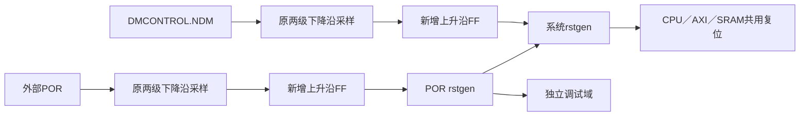

# 复位安全自动门控：TT验证与面积结果

已完成本轮必需验证，按既有课程例外口径通过。物理实现为 **346e467**，TT后仿与Lab5验证为 **bf2ff30**；后续只整理报告。两者之间的变更限于后仿测试及报告，RTL、物理脚本与物理配置一致。完整来源、SHA与实际检查见[最终记录](final_result.json)。

## 实测结果

| 指标 | 已验收关闭自动门控版3b9ef76 | 本轮 |
| --- | ---: | ---: |
| Genus Cell Area | 2.252109146 mm² | **2.124368263 mm²** |
| 原生逻辑Density | 82.746% | **77.191%** |
| 完整SoC RTL周期／硬件计数 | 2700／2695 | **2700／2695** |
| TT SDF原始用例周期／NPU周期 | 2701／952 | **2701／952** |
| TT Setup／Hold WNS | +0.100／+0.001 ns | **+0.126／0.000 ns** |
| 含PAD实现外框 | 3.7956390976 mm² | **3.7956390976 mm²** |

综合单元面积减少 **0.127740883 mm²（5.672%）**，回收原自动门控关闭开销的 **99.9347%**。较旧自动门控通用版仅多 **83.418 µm²**，对应新增两个重定时FF；原先未通过初始复位时序的旧自动门控版不能当作验收版本。相对原main的2.067330381 mm²，本轮通用功能总面积增加约2.759%。

新综合映射446个自动ICG、3285个原生受控FF；主SRAM仍一个8 KiB宏，面积401443.591 µm²。16 MAC、INT22、单双层FC、K/N分块和CPU/NPU编译部署功能保持。密度使用原生Density报告，未将Filler后的100%当作逻辑密度。Cell Area与Die外框属于不同口径，本轮节省的是单元面积，外框没有缩小。

Hold原生报告显示0.000 ns，TNS和负余量路径均为0；不将其描述为达到50 ps实测裕量。50 ps是优化软目标。面积、密度与原始行记录见[物理数据](physical_metrics.json)；同一批20项固件／检查清单SHA一致，19组门级周期与重叠计数逐项不变，见[门级性能对照](postsim_performance.json)。RTL原始41例也逐项不变。

## 修复方法与复位契约

保留原两级下降沿请求采样，维持两级之间一整周期的亚稳态稳定时间。POR和NDM各增加一个上升沿重定时FF，再接原rstgen，使复位断言在上升沿后传播，为复位相关自动ICG使能留出更完整的稳定窗口；同步释放仍在下降沿。

外部请求需要在时钟持续运行时保持两个下降沿及紧接的上升沿，保守识别延迟上界为2.5T，即20 ns时钟下50 ns，较原契约多半周期。它是复位请求识别延迟，推理周期未增加。SRAM地址、数据与字节掩码寄存器继续无异步复位，已接受事务在随后下降沿完成，后续请求在共同复位下停止。

这是有限相位与实际生产者路径的验证，不是任意异步相位零亚稳态或MTBF证明。POR异步入口第一级仍有采样孔径，原两级稳定时间未缩短。真实NDM由系统时钟域DMCONTROL寄存器产生；门级测试经DMI入口实际写入、读回1→3→1，验证断言、保持、释放及调试域独立，没有强制该寄存器输出异步跳变。

## 已完成验证

- RTL完整SoC、原始41例、10种单层尺寸／续算及8组PyTorch编译模型完整SoC通过；121个回归源文件、97个编译验证源文件重新核对SHA。
- POR／NDM各320个在途AXI/SRAM场景，共640场景；1282笔已接受写与实际执行逐笔一致，内容读回、字节写、读回压、AW无W及部分突发均通过。独立20 ns进程中原生SRAM时序检查开启，见[功能记录](functional.json)。
- 新Genus与34步Innovus全部完成，同一输入身份，681个回传文件校验通过。default DRC、完整核心PG、天线为0，信号连通按同源IO原生几何证据分类。
- **19/19功能用例、18组真实TT SDF**通过；初始复位、工作窗口、最终POR／NDM复位阶段的动态时序事件全部为0。回标error、缺失实例、缺失检查、负IOPATH截零全部为0。原生notifier、NTC、RECREM检查保留；原生IO在t=0的已记录模型启动信息和其他回标Warning未被伪称为零。
- 同一最终DB补充SRAM输入／输出半周期路径、公共复位到请求寄存器路径STA，六份报告均有正余量，没有ECO、加例外或改时钟。
- Lab5全流程完成：填充后非课程豁免DRC为0，LVS正确，天线0，64项Wire Bond全部0。原始DRC仍有2426条课程排除结果，ERC为7层次／977展开、逐对象核对后接受，**ERC Clean=false**，不是完整代工厂签核。Lab5输入与原物理输入SHA一致，当前RTL匹配物理版本。

SRAM输入最差Setup/Hold为 **6.256／10.117 ns**；输出为 **2.397／11.520 ns**；公共复位到请求寄存器为 **6.171／10.651 ns**。逐报告SHA见最终记录。

实现Die为1948.24 µm见方，3.7956390976 mm²，3.8 mm²课程上限适用于此实现边界。Lab5 SealRing外包络为1979 µm见方，**3.916441 mm²，超过3.8 mm²**，两种面积不混用。继续保留既有Lab5私有PAD的PP几何修复，原共享PDK未修改；具体对象见最终记录。

本轮按用户要求只做TT、20 ns、SI关闭、原生low-RC配置；未执行其他PVT、独立RC角、SI／IR／EM、功耗或新板测。

## 失败记录与流程修复

| 原始运行 | 实际停止原因 | 处理与证据 |
| --- | --- | --- |
| 692b950物理 | SRAM上沿2处M5普通信号短路，6轮detailRoute未消除 | [失败记录](failed_692b950.json)；原生ECO加当前报告信号网重布，有限次、最多64网；[隔离验证](native_repair_diagnostic.json)，新34步重新完成 |
| 346e467首次扩展SDF | 混合模型末尾强制同步NDM输出异步跳变，碰到第一级采样孔径 | [事件原文来源](failed_forced_ndm_346e467.json)；改为真实DMCONTROL写入，不屏蔽时序事件 |
| 02bde33 DMI检查 | 优化导出中恒零响应状态别名未驱动，观测为ZZ | [观察点记录](failed_dmi_observation_02bde33.json)；每写一次经真实响应FIFO读回DMCONTROL两位；[原生单例验证](dmcontrol_readback_sdf_smoke.json)，bf2ff30完整矩阵重跑通过 |
| bf2ff30首次Lab5 | 现有20 GB存储预算检查停止，未运行后续检查 | [停止记录](failed_storage_bf2ff30.json)；历史无损归档、相同SDF副本去重、既有白名单打包清理后，新建Lab5运行通过 |

两级采样器、原生库、SDF、notifier、时序约束及接受阈值没有为制造通过而删改。布线修复只操作当前独立DRC报告中的普通信号导线，不删除逻辑网或时钟／PG导线；检查和重试上限保留。正式测试为[在途事务回归](../../test/int8/tb_axi_sram_reset.sv)及[门级bench](../../eda/server/postsim/tb_postsim.sv)。

## 文件与结果位置

[最终记录](final_result.json)汇总服务器版本、本地目录、所有阶段输入身份、回传凭证、GDS与报告SHA；[功能记录](functional.json)、[门级性能](postsim_performance.json)、[面积密度](physical_metrics.json)分别提供对照依据。旧关闭门控基线及其失败修复链保留在[上一轮报告](../fc_generalization_eda_20261117/README.md)。

服务器物理版本：`uploads/20261117_140909_346e467`；后仿：`uploads/20261117_161131_postsim_vcs_tt_bf2ff30`；Lab5：`uploads/20261117_170532_lab5_bf2ff30`，均在`/home/s2400011041/Desktop/fullstack_chipdesign`下。大型GDS、SDF、原生模型和数据库留服务器。

[存储整理记录](storage_cleanup.json)保存7份历史无损归档的路径／SHA、15360个文件的校验依据、7个SDF副本字节不变的去重记录，以及既有严格白名单工具删除冗余core打包文件的凭证。历史归档在`archives/20261117_verified_history/`；逐文件manifest给出原目录，解压payload并恢复为原目录名即可恢复原路径。源码、原始报告、本轮版图与上一轮正式验收版本保留。清理后本轮Lab5按原6 GB预留／20 GB上限通过，没有放宽预算。

源码中没有新增一次性临时工具脚本；正式回归与可复用布线修复保留。自动审批拒绝了本轮四个本地ModelSim编译缓存目录的删除，返回原因仅为“blocked by policy”，因此这些缓存保留在忽略的runs目录；输入、日志与失败证据也保留。
