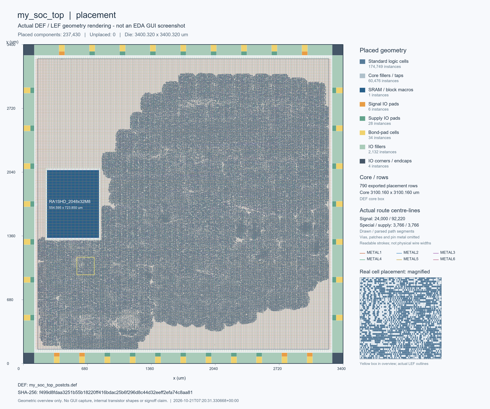
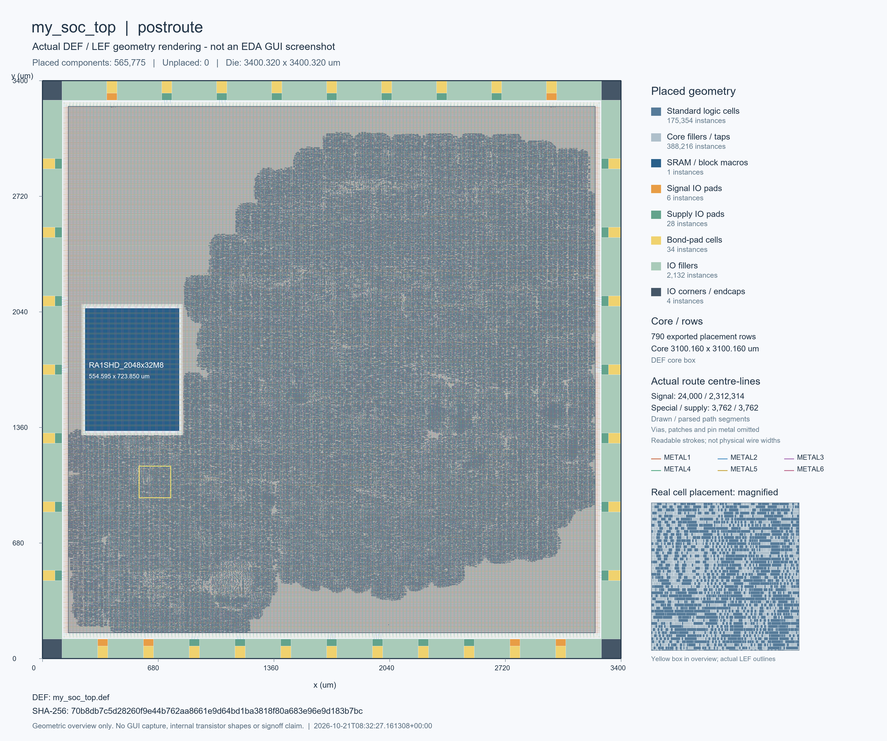

# 完整 SoC 实际版图预览

两图来自对应阶段导出的实际 DEF 和授权 LEF 的实例外框、放置坐标及布线路径中心线，属于几何渲染。图中显示了 SRAM、IO 环、标准单元、填充单元和局部放大。图内说明保留原始来源与范围。

它们不是 Innovus GUI 截图或制造照片，也不代替完整 GDS、DRC/LVS 或签核。信号布线路径仅抽样显示，未绘制所有 via 和 patch 几何。图片 SHA-256、源 DEF 身份和实例统计见 [来源记录](provenance.json)。原始工艺视图不进入仓库。

## CTS 后

实际 DEF 阶段为 `postcts`，共 237,430 个已放置实例；图内沿用渲染时的 `placement` 标签。

## 最终布线后

最终 DEF 阶段为 `postroute`，共 565,775 个已放置实例，包括 175,354 个逻辑标准单元、388,216 个 filler/tap 和 1 个主 SRAM 宏。

完整结果与上电协议见[物理实现记录](../../../../eda/pnr/RESULTS.md)，数据摘要见[本轮验收](../summary.json)。
